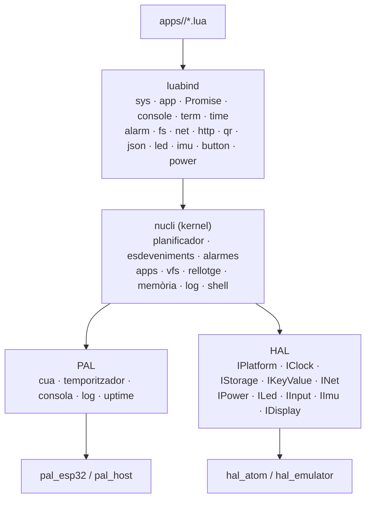
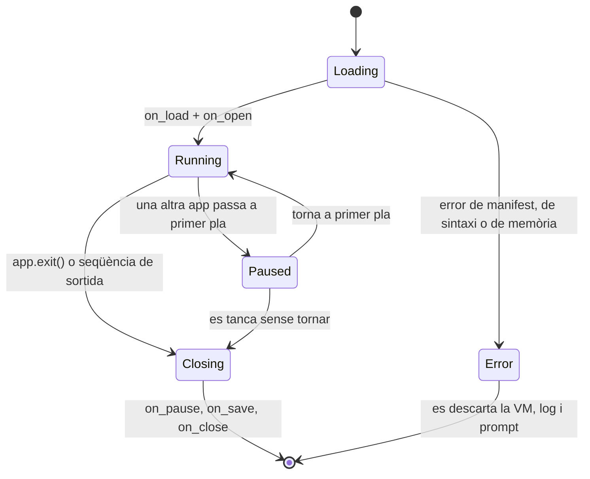

# 10 · Arquitectura

## Les capes



Tres idees que expliquen la resta:

1. **El nucli no sap quin maquinari hi ha.** Només pregunta `Platform::caps()` i crida interfícies.
2. **El nucli no sap quin sistema hi ha a sota.** No crida Arduino ni FreeRTOS ni `esp_*`: demana
   una cua, un temporitzador, un rellotge i una consola a la PAL.
3. **Les dues capes de sota són intercanviables per compilació.** `lib_ignore` fa que l'entorn de
   l'ATOM no vegi mai el codi de l'emulador i al revés.

## Qui pot cridar Lua

| Context | Pot cridar `lua_*` |
|---|---|
| Tasca del nucli | **Sí**, i només ella |
| Tasques auxiliars (xarxa, disc) | No. Només deixen anar esdeveniments POD a la cua |
| Interrupcions | No. Només encuen esdeveniments POD |
| Consola sèrie (lectura) | No. El nucli llegeix i després despatxa |

Aquesta és la regla que fa innecessari cap pany al voltant de l'intèrpret. Si mai cal un `mutex`
per tocar Lua, és que s'ha trencat aquesta regla.

## El bucle del nucli

```
per sempre (kernel::poll):
  espera     = el curt més proper: torn d'app, termini d'una promesa o
               la propera alarma                      (si no n'hi ha, l'oci)
  esdeveniment = cua.rebuda(espera)                  # bloqueja fins a l'esdeveniment o el termini
  si esdeveniment: despatxa(esdeveniment)
  net::poll()                                        # la ràdio, preguntada i mai esperada
  entrega les alarmes que toquen, i arma la propera
  button::poll()                                     # el botó, preguntat a cada torn
  power::poll()                                      # un son que una app ha demanat, entre torns
  desa les alarmes si la cua ha canviat
  llegeix la consola i l'encamina (a l'app o a la shell)
  shell::poll_app()                                  # el torn de l'app: reprèn la coroutine si toca
  led::poll()                                        # el llum, pintat a final de torn i només si canvia
```

Del bucle se'n dedueixen quatre coses:

- **No hi ha cap `delay`.** Quan el sistema no té res a fer, la cua el bloqueja fins al pròxim
  termini, i així el consum en repòs depèn del maquinari i no del codi.
- **Les alarmes no són esdeveniments d'una cua**: es miren a cada torn, i per això l'espera escurça
  fins al seu termini. Una alarma que venç mentre el nucli atenja una altra cosa no s'endarrereix
  més d'un torn.
- **El maquinari es pregunta, no avisa**: la ràdio, el botó i el llum són consultats a cada torn.
  Una interrupció només serviria per guanyar mil·lisegons que aquest sistema no necessita.
- **L'app té l'últim torn.** Quan li toca, la consola ja s'ha llegit i les alarmes ja s'han entregat,
  o sigui que un byte que acaba d'arribar ja és a la cua quan l'app desperta.

**El que hi ha és un pressupost d'instruccions per torn**: 20 000 des de la 0.174.7 —eren 100 000— i
ajustable amb `cfg turn <n>`, i en esgotar-se la tasca fa `lua_yield` i el nucli recupera el torn. Una app
que no cedeix no penja la placa: corre a trossos, i `!!exit`/3 ESC la tanquen. El número no és de rendiment
sinó **de latència**: és el que un dit al vidre o una tecla poden esperar que el nucli torni a mirar.
El matar amb `E_BUDGET` després de dos avisos encara no hi és (docs/20, docs/75).

## Esdeveniments

Tots els esdeveniments són estructures de mida fixa (POD), sense cap punter a memòria dinàmica, amb
una cua de mida fixa. La cua és un `xQueueSend` del sistema: si s'omple, la cua refusa l'esdeveniment
i qui el demanava rep `false`; no hi ha prioritats que descartar.

El nucli despatxa **tres** tipus, i la resta de la feina del torn no passa per la cua:

| Tipus | Qui el genera | Què fa el nucli |
|---|---|---|
| `kEventSystem` | el propi sistema (`a == 1` vol dir «plega») | atura el bucle |
| `kEventConsoleRx` | la consola | res aquí: la consola es llegeix a cada torn |
| `kEventTimer` | temporitzadors | res aquí: els terminis es compten a cada torn |

La resta de tipus de la PAL (`kEventAlarmDue`, `kEventPromiseDone`, `kEventAppExit`, `kEventPower`)
hi són declarats per al dia que calgui una cua de debò; avui les alarmes, les promeses, la sortida
d'una app i el son es miren a cada torn (docs/60).

## Arrencada

1. La PAL arrenca (consola, rellotge monòton, cua) i el log comença a l'anella de RAM. Tot seguit es
   llença un quart de segon de consola: la placa obre la UART abans que nosaltres i els primers bytes
   després d'un reset són brossa, i el shell no ha de respondre a bytes que ningú no ha escrit.
2. Es pregunta a la placa què té (`Platform::caps()`).
3. Es munten els volums. `/littlefs` és **obligatori** i es munta sempre; `/nvs` hi és si la placa
   el té, i `/sd` només a la placa que té ranura i amb una targeta a dins (el Paper: docs/50). Si
   `/littlefs` no munta, es registra l'error i el sistema segueix sense apps.
4. Es llegeix `cfg/` (si no hi és, s'agafa la configuració per defecte i es diu al log).
5. S'inicialitza el rellotge amb la millor font disponible.
6. Es reprodueixen les alarmes persistents que hagin vençut mentre el sistema era apagat.
7. S'obre el prompt `lunok>`.

**No hi ha cap registre d'apps a l'arrencada**: `/apps` es llegeix quan algú demana la llista, i el
temps d'arrencada no depèn de quantes apps hi hagi (docs/40).

Si qualsevol pas del 2 al 6 falla, el sistema **no s'atura**: deixa el log a la consola i obre el
prompt amb menys capacitats. **No hi ha mode segur** (encara): una placa que arrenca amb una app que
peta la tanca i torna al prompt, que és el camí de recuperació que hi ha avui.

## Estats d'una app



`Paused` existeix a la documentació, però a la v1 no s'hi arriba amb una segona app viva: quan una
alarma puja al davant una app, la de primer pla es **tanca** (`Closing`) i es reconstrueix després
si li toca. No hi ha dues apps carregades mai.

## Mapa del repositori

```
platformio.ini          set entorns: atom, atom_matrix, paper, esp32, tkoala, emulator i test
partitions.csv          particions pròpies (app + littlefs + nvs + coredump)
src/main.cpp            setup()/loop() d'Arduino: crida al nucli, res més
lib/
  kernel/               planificador, esdeveniments, gestor d'apps, vfs,
                        rellotge, memòria, log, shell, la política del llum,
                        del botó, de l'energia i de la ràdio; la vista d'una
                        app (ui.cpp), el buffer del vidre (display.cpp), la
                        barra del sistema (bar.cpp) i la seva font (font.cpp),
                        i el tàctil amb els gestos i el gir (touch.cpp,
                        orientation.cpp)
  alarms/               la cua d'alarmes, sense res de Lua a dins
  lua/                  Lua 5.4 vendoritzat, amb els flags de 20 · Intèrpret
  luabind/              la capa de Lua: un sol fitxer amb tota l'API de 30
  hal/                  capçaleres de les interfícies (no té codi)
  hal_esp32/            el que és del xip i no de cap placa: LittleFS, NVS,
                        rellotge, son, tecles en un GPIO, tira de WS2812, ràdio i
                        targeta SD (el fan servir les tres plaques d'ESP32, docs/50)
  pal/                  capçaleres de la capa de plataforma (no té codi)
  hal_atom/             el que és de la família M5 ATOM: la seva identitat, el pin
                        del llum i del botó i el MPU6886 del Matrix
  board_atom/           la identitat del Lite, només capçaleres: identity.h diu el
                        nom i 1 llum, impl.h diu què enllaçar
  board_matrix/         el mateix per al Matrix: "m5stack-atom-matrix" i 25 llums;
                        les dues no es veuen mai alhora (lib_ignore, docs/50)
  board_paper/          la identitat del Paper: "m5stack-paper", cap llum i cap
                        sensor (docs/50)
  hal_paper/            el que és de la M5 Paper: el *main power hold*, el dial de
                        tres tecles, la targeta al slot i el bus de la I2C
                        intern, amb el panell (IT8951) i el tàctil (GT911)
                        damunt del que és del xip, a hal_esp32 (docs/50)
  board_tkoala/         la identitat del LilyGO T-Koala: "ttgo-t-koala", un LED
                        i cap sensor (docs/50)
  hal_tkoala/           el que és del T-Koala: el LED de GPIO5, la targeta
                        als pins HSPI i el PSRAM del WROVER-B
  hal_emulator/         implementació per al PC (inclou main() de l'emulador);
                        mateixes capçaleres, i la identitat respon el model que
                        se li ha dit (`--board`, docs/85)
  pal_esp32/            FreeRTOS/ESP-IDF
  pal_host/             POSIX
  json/                 analitzador JSON de tracció, per a manifests i cfg
  qr/                   qualsevol QR que aquest build pugui dibuixar
boards/                 definicions de placa que PlatformIO no porta: la del Paper
                        i la del T-Koala (boards_dir a platformio.ini, docs/80)
apps/                   les apps del projecte, una carpeta per id (`apps/<id>/`),
                        amb el seu `manifest.json` i, si en té, els seus `res/`
data/                   el que és del sistema a la imatge de la LittleFS: `res/` i
                        `data/`. Les apps no hi són: el disc de cada placa el
                        munta `tools/make_disk.py` a `build/disk/<entorn>` (docs/70)
emulator/               disc de proves de l'emulador (fora del git)
test/                   proves natives (Unity) i guions per a l'emulador
docs/                   aquests documents
```

## La documentació

Aquests documents expliquen **com funciona el projecte avui**, i tenen tres regles:

- **El codi mana.** Si un document i el codi no diuen el mateix, el document està malament. Quan es
  canvia una cosa, es canvia el document que la descriu **al mateix commit**.
- **No és un historial.** El que s'ha arreglat, quan i amb quant de flash ho diu git
  (`git log`), i les mètriques vives són a `75`. Un document que es va omplint de cròniques deixa de
  ser llegible just quan més falta fa.
- **El que no hi és es diu.** Una crida del contracte sense codi al darrere va marcada, i el que no
  s'ha mesurat es diu **pendent** en comptes de donar un número que ningú ha pres.

`90 · Full de ruta` és l'única llista de feina, i només té el que falta.

## On va cada cosa nova

| Vull afegir… | On va |
|---|---|
| Una crida nova de Lua | `lib/luabind/` + contracte a `30 · API` + prova |
| Una peça de maquinari nova | Interfície a `lib/hal/`; si és del xip i no d'una placa, a `lib/hal_esp32/`; si no, a cada `hal_<placa>` |
| Una placa nova | `lib/board_<id>/` amb `include/board/identity.h` (el nom de la placa i quants llums té) i `impl.h`, el seu `-I` a `platformio.ini` i les altres plaques a `lib_ignore`; si la placa no té HAL, a més `lib/hal_<id>/` |
| Una regla que val per a totes les plaques | `lib/kernel/` |
| Una cosa que depèn del sistema de sota | `lib/pal/` i les dues `pal_*` |
| Una app | `apps/<id>/`, mai dins del nucli; el disc de cada placa el munta `tools/make_disk.py` |
| Una llibreria d'utilitat | `lib/<nom>/`, i **exposada a Lua** (vegeu a sota) |

## Tota llibreria d'utilitat es veu des de Lua

**La regla (30/10):** una llibreria que fa una cosa útil i que cap app pot cridar és una llibreria a
mitges. Si el càlcul no depèn de res del sistema (no toca maquinari, no toca fitxers), **s'exposa a
Lua** amb la seva taula; si depèn del sistema, s'exposa a través de la crida del nucli que decideix
(com `net.*`, que no és la HAL sinó la política del nucli). I si no s'exposa, **es diu per què** en
aquest mateix document.

| Llibreria | Què fa | Com es veu des de Lua |
|---|---|---|
| `alarms` | cua d'alarmes ordenada, amb repeticions i comptador de perdudes | taula `alarm` (`alarm.at`, `after`, `cancel`, `list`, `caps`) |
| `json` | llegir un camp d'un text JSON sense construir cap arbre | taula `json` (`json.get_string`, `json.get_int`) |
| `qr` | qualsevol QR: versions 1-20, nivells L/M/Q/H, modes numèric, alfanumèric i byte | taula `qr` (`qr.encode`, `qr.caps`) |
| `lua` | l'intèrpret | és el que hi ha a sota de tot; l'app ja el fa servir |
| `hal` | el maquinari | **mai directa**: `fs.*`, `net.*`, `time.*`, `console.*` passen pel nucli, que és qui decideix quan encendre, quan esperar i quan dir que no |
| `pal` | porta sèrie, consola, cues | `console.*` i `term.*` |
| `kernel` | VFS, shell, xarxa, apps | `fs.*`, `net.*`, `http.get`, `app.*`, `sys.*` |
| `epub` | l'EPUB: el zip, l'OPF, el XHTML i el paginador | taula `epub` (`epub.open`, `books`, `page`, `picture`…, docs/46) |
| `img` | PNG, JPEG, BMP, GIF, ICO i netpbm, amb la màscara i el dither | **no directa**: `ui.image`, `cv:image` i `ui.image_info` hi passen pel nucli, que és qui té el canvas on va el dibuix |
| `inflate` | deflate en un bloc del qui crida | **no directa**: `zip` i `img` la fan servir; una app no té res a fer-ne |
| `zip` | el zip d'un llibre: directori central, entrades `stored` i `deflate` | **no directa**: `epub` hi passa pel damunt (docs/46 B8 deixa `zip.extract` com a pendent) |
| `ttf` | una cara d'outlines d'un `.ttf` | **no directa**: `ui.load_font` i les cares de `/fonts` hi passen pel nucli |

Una llibreria nova que no aparegui en aquesta taula és un oblit, no una decisió: quan se n'afegeix una,
s'afegeix aquí amb el que en veu Lua, o amb el motiu de no veure-hi res.
